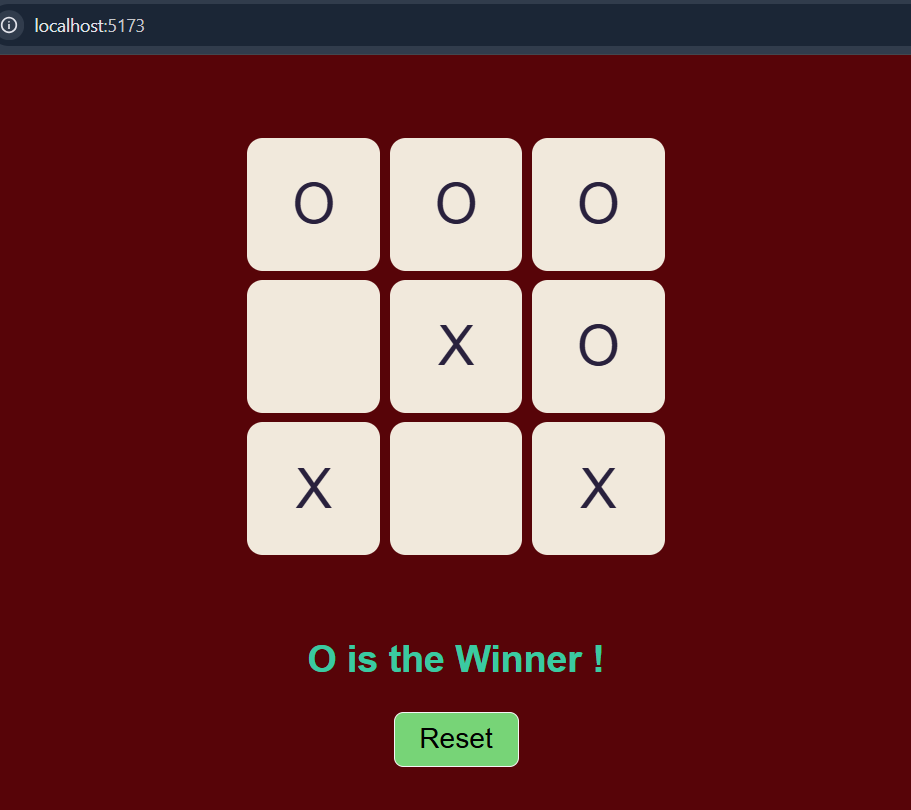

# Tic Tac Toe Game 🎮

A simple two-player Tic Tac Toe game built using React. Players take turns marking X and O on a 3×3 grid. The game automatically detects the winner or declares a draw.

##  Screenshot



##  Features

- Two-player gameplay (X and O)
- Automatic winner detection
- Draw detection
- Turn management
- Reset button to start a new game

##  Tech Stack

- React
- JavaScript
- HTML
- CSS

##  What I Learned

- Managing state using `useState`
- Handling click events in React
- Updating arrays without directly mutating state
- Conditional rendering
- Implementing winner and draw detection logic

##  Challenges & Learning

Initially, I found it difficult to figure out how to build the game logic on my own. I referred to a YouTube tutorial to understand the approach, practiced the implementation again, and eventually managed to build the logic myself.

This project helped me improve my problem-solving skills and understand how to break a problem into smaller steps.

## 🎥 Tutorial Reference

[YouTube Tutorial](https://www.youtube.com/watch?v=D_tyfqNZm6I&list=PLp18NAIKHWnvpLpioGs6ZAiMlpfx49KOz&index=35)

## ▶️ Run Locally

1. Clone the repository:

   ```bash
   git clone https://github.com/Rohitkashyap-22/React-Tic-Tac-Toe
   ```

2. Navigate to the project folder:

   ```bash
   cd React-Tic-Tac-Toe
   ```

3. Install dependencies:

   ```bash
   npm install
   ```

4. Start the development server:

   ```bash
   npm run dev
   ```

---

Built as a React practice project.
